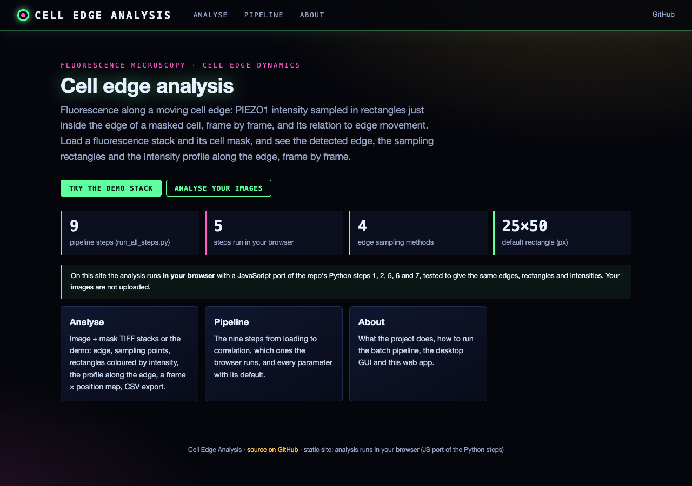
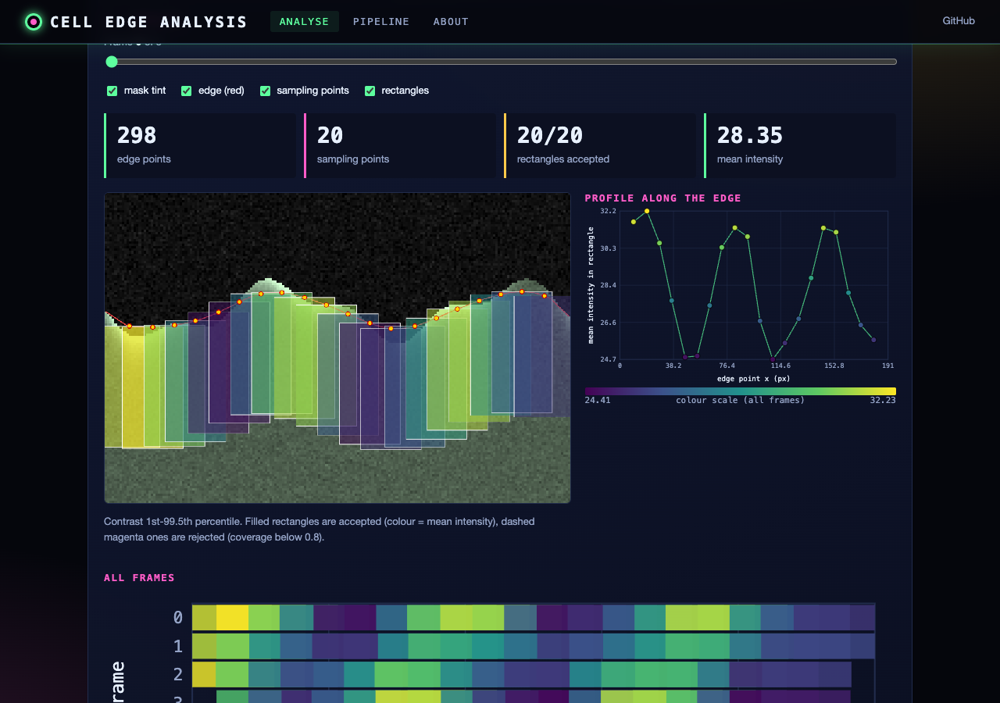
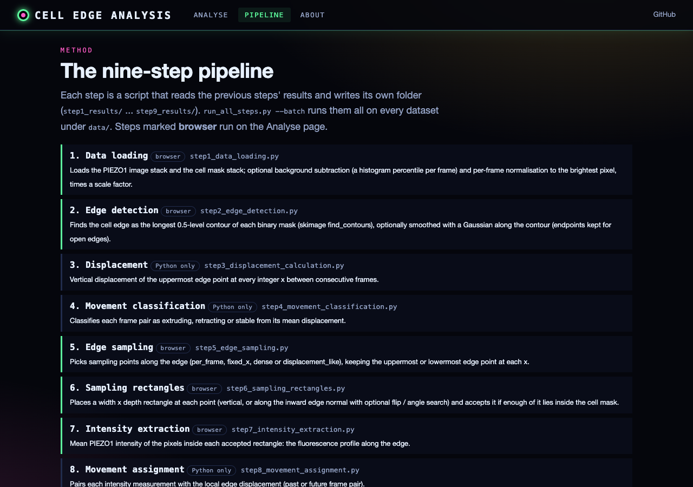

# Cell Edge Movement Analysis Pipeline

A comprehensive Python pipeline for analyzing PIEZO1 protein localization and cell edge dynamics using fluorescence microscopy data.

## 📋 Table of Contents

- [Quick Start](#quick-start)
- [What This Pipeline Does](#what-this-pipeline-does)
- [Installation](#installation)
- [Basic Usage](#basic-usage)
- [Batch Processing](#batch-processing)
- [Configuration](#configuration)
- [Individual Steps](#individual-steps)
- [Output Files](#output-files)
- [Troubleshooting](#troubleshooting)
- [Advanced Features](#advanced-features)

---

## 🚀 Quick Start

### 1. Prepare Your Data

Organize your data in this structure:
```
data/
├── experiment1/
│   ├── experiment1_piezo1.tif    # PIEZO1 fluorescence images
│   └── experiment1_Mask.tif      # Cell mask
├── experiment2/
│   ├── experiment2_piezo1.tif
│   └── experiment2_Mask.tif
└── experiment3/
    ├── experiment3_piezo1.tif
    └── experiment3_Mask.tif
```

**File naming requirements:**
- PIEZO1 images: Must contain `piezo1`, `Piezo1`, or `PIEZO1` in filename
- Masks: Must contain `Mask`, `mask`, or `MASK` in filename

### 2. Run the Pipeline

```bash
# Process all datasets automatically
python run_all_steps.py --batch
```

### 3. View Results

```bash
# Get summary of all results
python summarize_batch_results.py results/

# Generate combined analysis
python combined_batch_analysis.py
```

**That's it!** Your correlation analysis results are in `results/DATASET/step9_results/final_analysis_summary.json`

---

## 🔬 What This Pipeline Does

The pipeline analyzes the relationship between **cell edge movement** and **PIEZO1 protein localization**:

1. **Loads and preprocesses** fluorescence images and cell masks
2. **Detects cell edges** from masks
3. **Calculates edge displacement** between frames
4. **Classifies movement** (extruding/retracting/stable)
5. **Samples edge points** for intensity measurement
6. **Creates sampling rectangles** perpendicular to edge
7. **Extracts PIEZO1 intensities** at edge locations
8. **Assigns movements** to intensity measurements
9. **Correlates intensity with movement** and performs statistical analysis

**Output:** Correlation coefficient between PIEZO1 intensity and cell edge movement direction.

---

## 💻 Installation

### Requirements

- Python 3.7+
- Required packages:
  ```bash
  pip install numpy scipy matplotlib scikit-image tifffile
  ```

### Optional (for enhanced features)

- `pandas` - for CSV export
- `seaborn` - for enhanced visualizations

---

## 📖 Basic Usage

### Option 1: Automated Pipeline (Recommended)

Process all your datasets with one command:

```bash
python run_all_steps.py --batch
```

The script will:
- Automatically find all datasets in `data/` folder
- Process each through all 9 analysis steps
- Save organized results in `results/` folder
- Show progress and timing for each step

### Option 2: Single Dataset

Process one dataset at a time:

```bash
python run_all_steps.py --batch --dataset experiment1
```

### Option 3: Manual Step-by-Step

Run individual steps for fine control:

```bash
python step1_data_loading.py --image-stack-path data/exp1/exp1_piezo1.tif \
                             --mask-stack-path data/exp1/exp1_Mask.tif

python step2_edge_detection.py --input-dir step1_results

python step3_displacement_calculation.py --input-dir-step1 step1_results \
                                        --input-dir-step2 step2_results

# ... continue through step9
```

---

## 🔄 Batch Processing

### Basic Batch Processing

```bash
# Process all datasets
python run_all_steps.py --batch

# Interactive prompt:
# Found 3 dataset(s):
#   1. experiment1
#   2. experiment2
#   3. experiment3
# Process all 3 datasets? [y/N]: y
```

### Custom Directories

```bash
python run_all_steps.py --batch \
    --data-dir /path/to/your/data \
    --results-dir /path/to/results
```

### Test on One Dataset First

```bash
# Test parameters on single dataset
python run_all_steps.py --batch --dataset experiment1

# Review results
cat results/experiment1/step9_results/final_analysis_summary.json

# If satisfied, process all
python run_all_steps.py --batch
```

---

## ⚙️ Configuration

### Adjusting Parameters

All defaults live in one module, `pipeline_defaults.py` (`DEFAULTS`), which `run_all_steps.py`, every step script,
the desktop GUI and the web app read. Edit it to customize analysis parameters:

```python
DEFAULTS = {
    # Step 1: Preprocessing
    'step1': {
        'normalize_frames': True,           # Normalize intensity
        'subtract_background': True,        # Remove background (recommended)
        'background_percentile': 10,        # Background level (0-100)
        'normalization_scale': 100.0,       # Scaling factor
        'create_verification_figures': True # Quality control images
    },

    # Step 2: Edge Detection
    'step2': {
        'smooth_edges': True,               # Smooth noisy edges (recommended)
        'smoothing_sigma': 20.0,            # Smoothing strength
        'create_verification_figures': True
    },

    # Step 4 & 9: Movement Classification
    'step4': {
        'movement_threshold': 5,            # Threshold in pixels
        # ...
    },
    'step9': {
        'movement_threshold': 5,            # Should match step4
        'binning_method': 'equal_count',    # Binning approach
        'n_bins': 10,                       # Number of bins
        # ...
    }
}
```

> **Changed (2026-11):** the desktop GUI used to start with `n_points` 10 and `target_points_displacement` 5, and
> ran step 8 with `temporal_direction` 'past', while `run_all_steps.py` used 12, 20 and 'future'. All entry points
> now use the pipeline values from `pipeline_defaults.py`, so GUI results on the same data can differ from earlier
> GUI runs (more sampling points per frame; intensities paired with the following frame pair).

### Recommended Settings

**For typical PIEZO1 imaging:**
```python
'step1': {
    'subtract_background': True,      # Enable
    'background_percentile': 10,      # Conservative
}
'step2': {
    'smooth_edges': True,             # Enable
    'smoothing_sigma': 5.0,           # Moderate
}
```

**For high-quality data:**
```python
'step1': {'subtract_background': False}
'step2': {'smooth_edges': False}
```

**For noisy data:**
```python
'step1': {'background_percentile': 15}  # More aggressive
'step2': {'smoothing_sigma': 20.0}       # Stronger smoothing
```

### Speed Optimization

Disable verification figures for 3-5x faster processing:

```python
'create_verification_figures': False  # Set for all steps
```

---

## 📊 Individual Steps

Each step can be run independently with command-line arguments:

### Step 1: Data Loading & Preprocessing

```bash
python step1_data_loading.py \
    --image-stack-path data/exp1/exp1_piezo1.tif \
    --mask-stack-path data/exp1/exp1_Mask.tif \
    --output-dir step1_results \
    --subtract-background true \
    --background-percentile 10
```

**Key parameters:**
- `--subtract-background` - Remove background noise (true/false)
- `--background-percentile` - Percentile for background (0-100, default: 10)
- `--normalization-scale` - Scale normalized values (default: 100.0)

### Step 2: Edge Detection

```bash
python step2_edge_detection.py \
    --input-dir step1_results \
    --output-dir step2_results \
    --smooth-edges true \
    --smoothing-sigma 2.0
```

**Key parameters:**
- `--smooth-edges` - Apply Gaussian smoothing (true/false)
- `--smoothing-sigma` - Smoothing strength (default: 20.0, range: 0.5-50.0)

### Step 3: Displacement Calculation

```bash
python step3_displacement_calculation.py \
    --input-dir-step1 step1_results \
    --input-dir-step2 step2_results \
    --output-dir step3_results \
    --min-movement-pixels 5
```

**Key parameters:**
- `--min-movement-pixels` - Minimum displacement threshold (default: 5)

### Step 4: Movement Classification

```bash
python step4_movement_classification.py \
    --input-dir-step1 step1_results \
    --input-dir-step2 step2_results \
    --input-dir-step3 step3_results \
    --output-dir step4_results \
    --movement-threshold 5
```

**Key parameters:**
- `--movement-threshold` - Threshold for extruding vs retracting (default: 5 pixels)

### Step 5: Edge Point Sampling

```bash
python step5_edge_sampling.py \
    --input-dir-step1 step1_results \
    --input-dir-step2 step2_results \
    --output-dir step5_results \
    --sampling-method displacement_like \
    --target-points-displacement 20
```

**Key parameters:**
- `--sampling-method` - Sampling strategy (per_frame/fixed_x/dense/displacement_like)
- `--target-points-displacement` - Points per frame for displacement_like (default: 20)
- `--y-selection` - Select uppermost or lowermost edge points (uppermost/lowermost)

### Steps 6-9

Continue similarly for remaining steps. Use `--help` with any script to see all options:

```bash
python step6_sampling_rectangles.py --help
python step7_intensity_extraction.py --help
python step8_movement_assignment.py --help
python step9_correlation_analysis.py --help
```

---

## 📁 Output Files

### Directory Structure

```
results/
└── experiment1/
    ├── step1_results/
    │   ├── images.npy                          # Preprocessed images
    │   ├── masks.npy                           # Binary masks
    │   ├── metadata.json                       # Processing parameters
    │   └── verification_figures/               # Quality control images
    ├── step2_results/
    │   ├── edges.pkl                           # Detected edges
    │   ├── edge_statistics.json
    │   └── verification_figures/
    ├── step3_results/
    │   ├── displacement_data.pkl               # Edge displacements
    │   └── verification_figures/
    ├── step4_results/
    │   ├── movement_classifications.pkl
    │   ├── classification_statistics.json
    │   └── verification_figures/
    ├── step5_results/
    │   ├── sampled_edges.pkl                   # Sampling points
    │   └── verification_figures/
    ├── step6_results/
    │   ├── sampling_rectangles.pkl
    │   └── verification_figures/
    ├── step7_results/
    │   ├── intensity_data.pkl                  # PIEZO1 intensities
    │   └── verification_figures/
    ├── step8_results/
    │   ├── combined_data.pkl                   # Intensities + movements
    │   ├── combined_statistics.json
    │   └── verification_figures/
    └── step9_results/                          ⭐ MAIN RESULTS
        ├── final_analysis_summary.json         ⭐ Correlation results
        ├── correlation_results.pkl             # Same results, for the GUI
        └── verification_figures/               # Scatter, binned analysis and summary plots
```

### Key Results File

**`final_analysis_summary.json`** contains (keys as written by `step9_correlation_analysis.py`):

```
correlation_analysis
  n_points
  overall: pearson_r, r_squared, p_value, slope, intercept, std_err
  by_movement_type: extruding / retracting / stable -> n, mean_intensity, std_intensity, mean_displacement
  comparison_tests: extruding_vs_retracting -> t_statistic, t_pvalue, mann_whitney_u, mann_whitney_p
movement_classifications: n_frame_pairs, extruding, retracting, stable
data_summary: n_frames_with_data, total_valid_points
```

### Quick Results Check

```bash
# View correlation for all datasets
grep pearson_r results/*/step9_results/final_analysis_summary.json

# Get formatted summary
python summarize_batch_results.py results/

# Export to CSV
python summarize_batch_results.py results/ --csv summary.csv
```

---

## 🔧 Troubleshooting

### "No datasets found"

**Problem:** Files don't match expected naming patterns

**Solution:**
```bash
# Check filenames
ls data/your_dataset/

# Rename to match pattern:
mv your_image.tif experiment_piezo1.tif
mv your_mask.tif experiment_Mask.tif
```

### "Step X failed"

**Problem:** Error during processing

**Solution:**
```bash
# 1. Check verification figures from previous step
ls results/dataset/stepX-1_results/verification_figures/

# 2. Review error message in terminal

# 3. Rerun that step manually with verbose output
python stepX_script.py --input-dir ... --output-dir ...

# 4. Check if preprocessing parameters need adjustment
```

### "Out of memory"

**Problem:** Large datasets exhausting RAM

**Solution:**
```python
# In pipeline_defaults.py, disable verification figures:
'create_verification_figures': False  # For all steps
```

### "Results don't look right"

**Problem:** Parameters not optimal for your data

**Solution:**
```bash
# 1. Test different preprocessing settings
python run_all_steps.py --batch --dataset test_1

# 2. Check verification figures at each step
ls results/test_1/*/verification_figures/

# 3. Adjust parameters in pipeline_defaults.py

# 4. Reprocess and compare
```

### "Background subtraction too aggressive"

**Problem:** Removing actual signal

**Solution:**
```python
# Reduce background percentile
'background_percentile': 5  # Instead of 10
```

### "Edges still noisy after smoothing"

**Problem:** Insufficient smoothing

**Solution:**
```python
# Increase smoothing sigma
'smoothing_sigma': 3.0  # Instead of 2.0
```

---

## 🎓 Advanced Features

### Preprocessing Options (New in v2.2.0)

**Background Subtraction:**
- Removes uniform background fluorescence
- Based on histogram percentile
- Applied before normalization
- Recommended for most datasets

**Normalization Scaling:**
- Scales normalized values to custom range
- Useful for matching specific intensity scales
- Default scale 100.0 (range [0, 100]); 1.0 gives [0, 1]

**Example:**
```python
'step1': {
    'subtract_background': True,
    'background_percentile': 10,
    'normalization_scale': 255  # Scale to 8-bit range
}
```


### Edge Smoothing (New in v2.3.0)

**Gaussian Edge Smoothing:**
- Reduces noise in detected edges
- Smooths frame-to-frame jitter
- Preserves endpoints to prevent artifacts
- Recommended for typical imaging data

**Example:**
```python
'step2': {
    'smooth_edges': True,
    'smoothing_sigma': 2.0  # Moderate smoothing
}
```


### Combined Analysis

Analyze all datasets together for higher statistical power:

```bash
# After batch processing
python combined_batch_analysis.py

# Results in: combined_analysis/combined_correlation_statistics.json
```

This pools data from all datasets to compute an overall correlation.


### Custom File Patterns

If your files use different naming conventions, edit `FILE_PATTERNS` in `pipeline_defaults.py`:

```python
FILE_PATTERNS = {
    'IMAGE_PATTERNS': ['*_TIRF.tif', '*_GFP.tif'],
    'MASK_PATTERNS': ['*_binary.tif', '*_seg.tif'],
}
```


## 🎯 Typical Workflow

### 1. Setup

```bash
# Create directory structure
mkdir -p data/experiment1 data/experiment2

# Copy your TIFF files into folders
# (Ensure filenames contain 'piezo1' and 'Mask')
```

### 2. Test Configuration

```bash
# Process one dataset
python run_all_steps.py --batch --dataset experiment1

# Check results
cat results/experiment1/step9_results/final_analysis_summary.json

# Review verification figures
ls results/experiment1/*/verification_figures/
```

### 3. Adjust Parameters (if needed)

```python
# Edit pipeline_defaults.py
# Modify preprocessing or analysis parameters
```

### 4. Process All Data

```bash
# Run complete batch
python run_all_steps.py --batch
```

### 5. Analyze Results

```bash
# Get summary
python summarize_batch_results.py results/

# Combined analysis
python combined_batch_analysis.py

# Export for further analysis
python summarize_batch_results.py results/ --csv results.csv
```


---

## 🌐 Web interface

Edge detection and the fluorescence-along-the-edge profile (pipeline steps 1, 2, 5, 6, 7) on your own image + mask
stacks, in the browser. Live site: https://gddickinson.github.io/cell_edge_analysis/

| Home | Analyse (synthetic demo) | Pipeline |
|---|---|---|
|  |  |  |

```bash
pip install -r requirements-web.txt
python run_web.py                 # http://127.0.0.1:8124
```

- **Analyse**: load a fluorescence TIFF stack and its mask stack (or the synthetic demo), set the step 1/2/5/6
  parameters (defaults from `pipeline_defaults.py`), and step through frames: detected edge, sampling points, rectangles
  coloured by mean intensity, the intensity profile along the edge, a frame × x map of all frames, a points table and
  CSV export (with the pixel size if the TIFF records one).
- The analysis runs in the browser with a JavaScript port (`web/static/edge_engine.js`, `contours.js`) of the repo's
  Python steps, so the static site is fully functional and nothing is uploaded. `web/static/edge_engine.test.mjs`
  checks it against Python (`tests/fixtures/edge_fixture.json`, from `scripts/make_edge_fixture.py`) for every
  sampling and rotation method.
- The local app additionally reads compressed TIFFs with tifffile and has a **Check with Python** button that re-runs
  the frame with the repo's own step functions (`web/analysis.py`).
- Steps 3, 4, 8 and 9 (edge movement and the intensity-movement correlation) stay in the batch pipeline / desktop GUI.
- The demo stack (`web/static/demo/`, from `scripts/make_demo_data.py`) is **synthetic**, not measured data.

Static site: `python scripts/build_static.py` (published by `.github/workflows/pages.yml` on push to main).
Tests: `python -m pytest -q tests` and `node web/static/edge_engine.test.mjs`.
